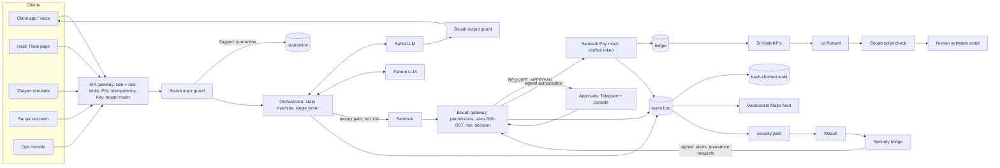

# Architecture

Two paths never mix: the money path (offer accepted → Bouab → approval → signed
authorization → Sandouk Pay → ledger → KPIs) is deterministic code; the AI path
(Sahbi, Fahem, Le Renard) has timeouts and falls back to Replay or MOCK, and never
blocks money.
